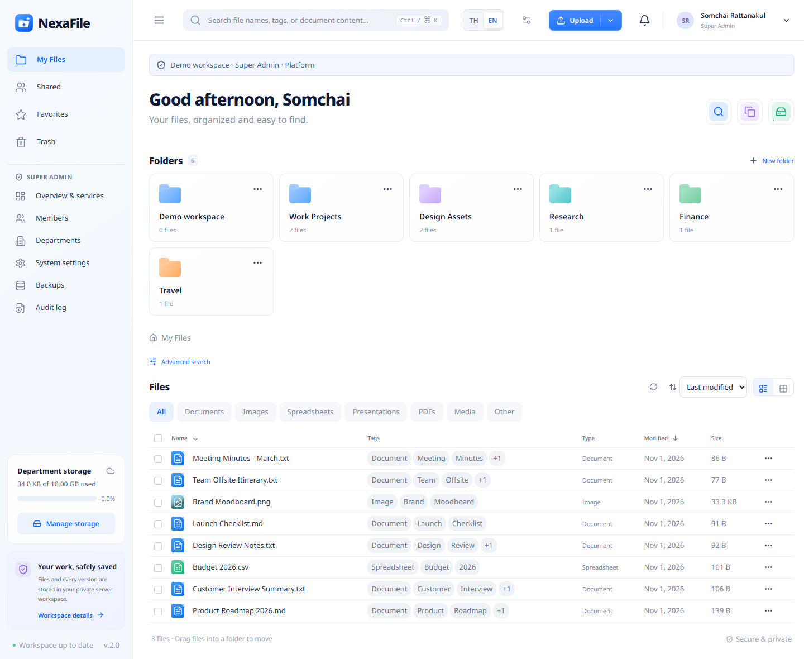
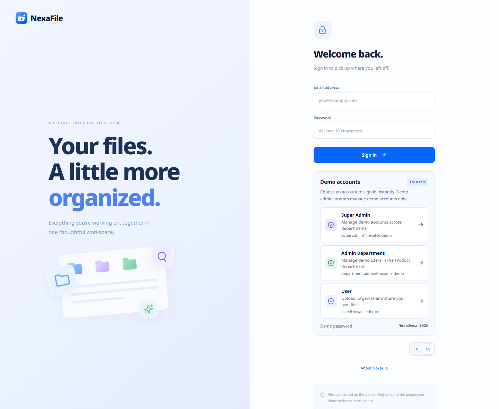
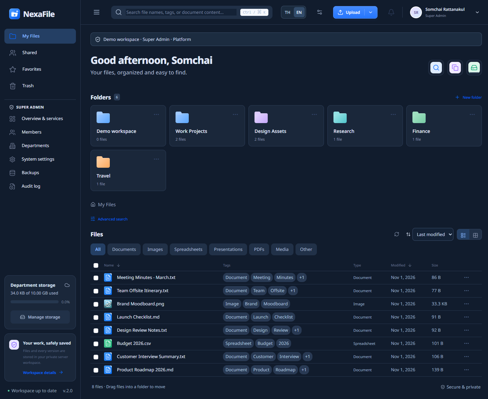
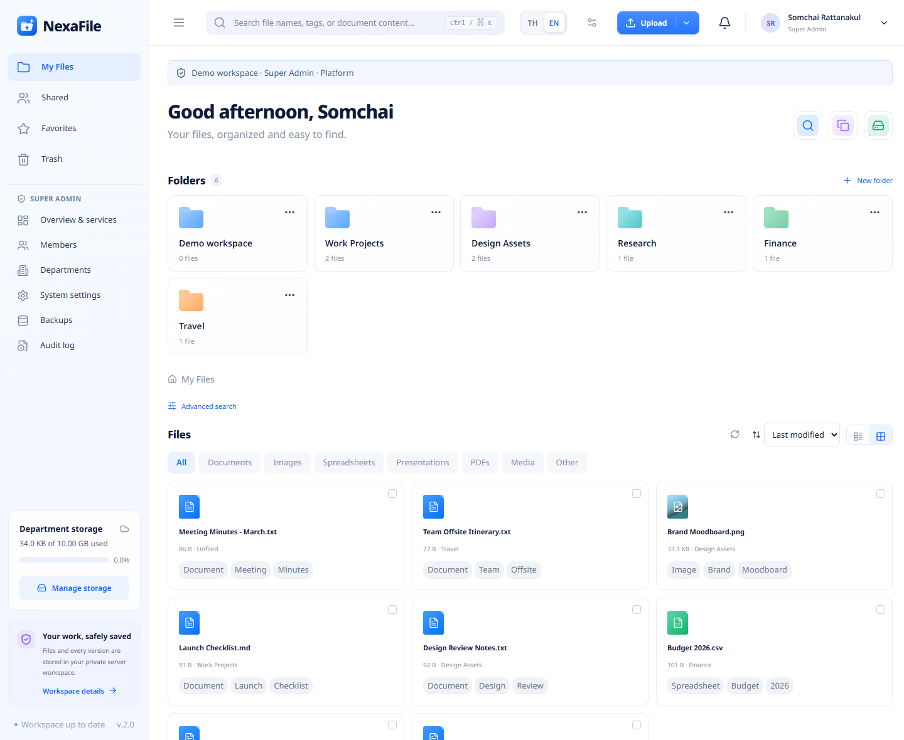
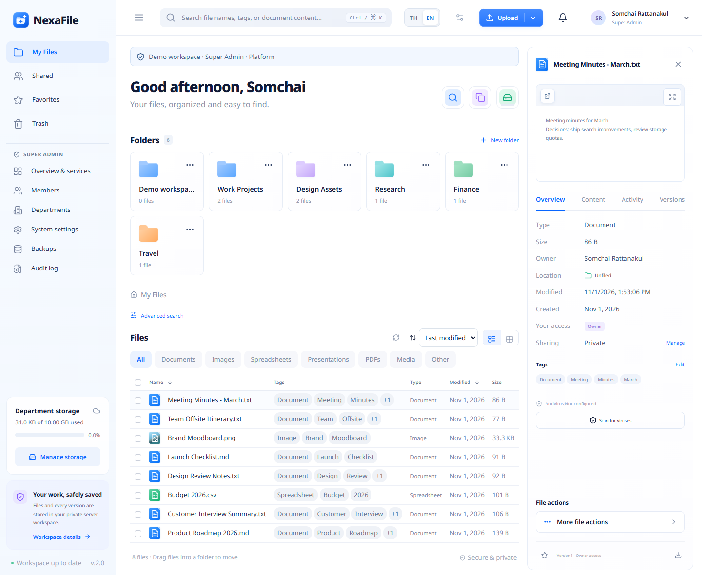
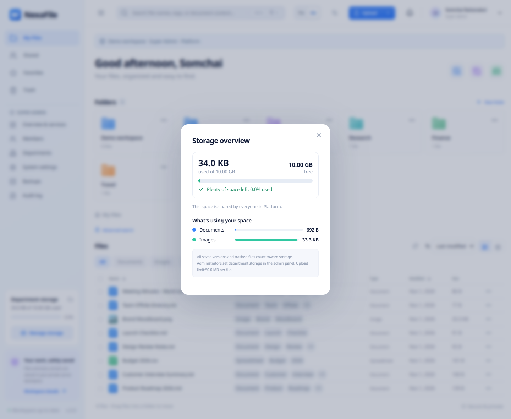
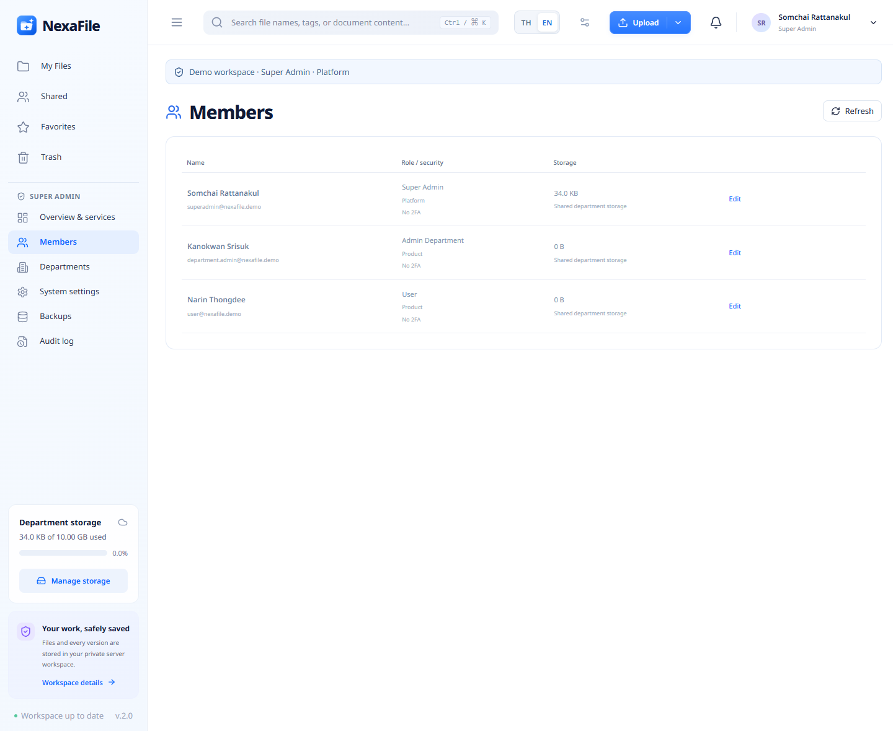
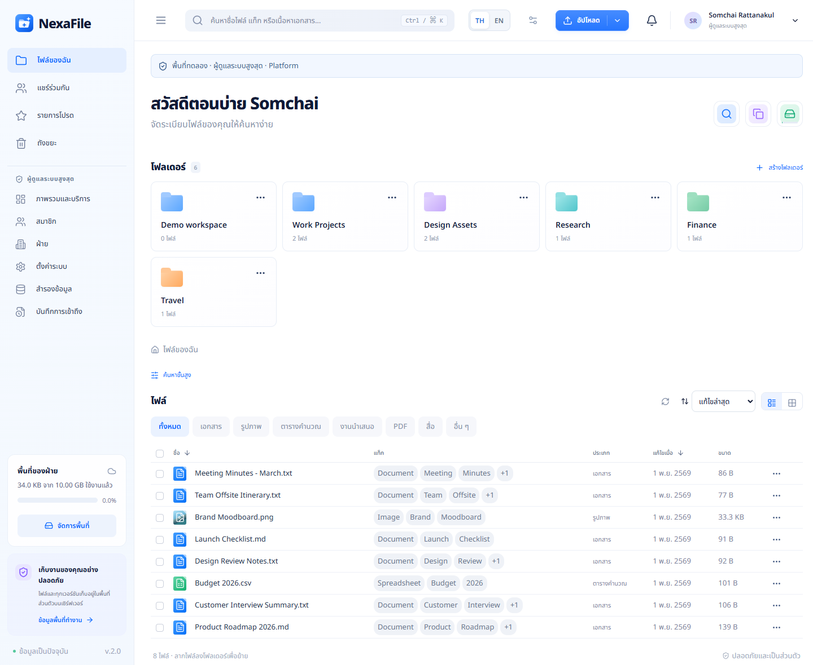
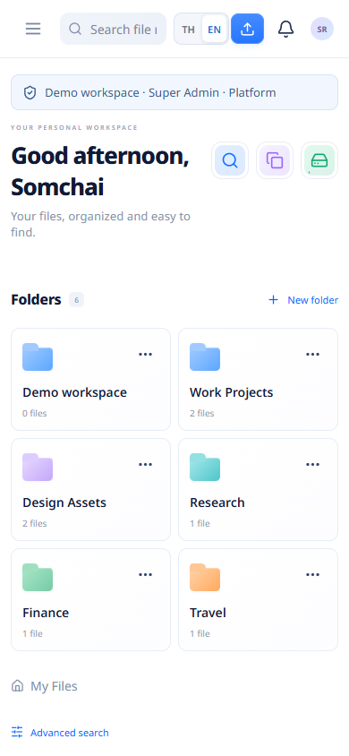
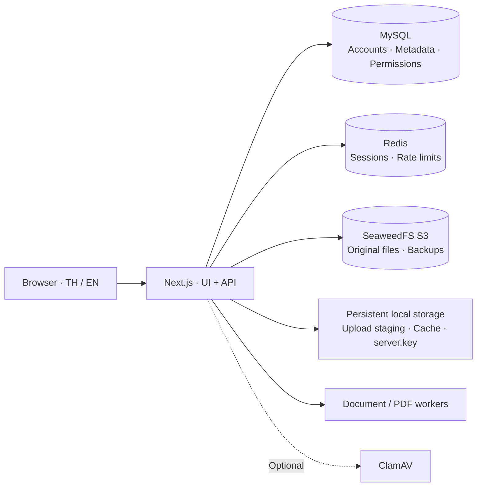

<p align="center">
  
</p>

<h1 align="center">NexaFile</h1>

<p align="center">
  A file management workspace for teams, with content search and version history.<br />
  Thai and English interfaces · Role and department access controls · S3 object storage
</p>

<p align="center">
  
  
  
  
</p>

NexaFile brings file storage, sharing, version history, and search into one web application. It uses **MySQL** for application data, **Redis** for sessions and rate limits, and **SeaweedFS through the S3 API** for original files and backups.

[Screenshots](#screenshots) · [Quick start with Docker](#quick-start-with-docker) · [Getting started](#getting-started) · [Configuration](#configuration) · [Demo accounts](#demo-accounts) · [Testing](#testing) · [Operations](#operations)

## Screenshots

<p align="center">
  
</p>

<table>
  <tr>
    <td width="50%"><br /><sub><b>Sign in</b> — email and password, or one-click demo roles.</sub></td>
    <td width="50%"><br /><sub><b>Dark mode</b> — light, dark or follow the system.</sub></td>
  </tr>
  <tr>
    <td width="50%"><br /><sub><b>Grid view</b> — table or grid, with sorting and type filters.</sub></td>
    <td width="50%"><br /><sub><b>File details</b> — preview, tags, sharing, activity and versions.</sub></td>
  </tr>
  <tr>
    <td width="50%"><br /><sub><b>Storage overview</b> — used and free space in plain language, with a breakdown by type.</sub></td>
    <td width="50%"><br /><sub><b>Admin console</b> — members, departments, quotas, backups and audit log.</sub></td>
  </tr>
  <tr>
    <td width="50%"><br /><sub><b>Thai and English</b> — switch language at any time.</sub></td>
    <td width="50%" align="center"><br /><sub><b>Mobile</b> — responsive layout with a slide-in menu.</sub></td>
  </tr>
</table>

> The screenshots use invented sample files and demo accounts, not real data.

## Quick start with Docker

The fastest way to run everything (app, MySQL, Redis, SeaweedFS S3 and ClamAV) with no external services:

```sh
cp .env.docker.example .env      # then replace every CHANGE_ME with a long random value
docker compose up -d --build
```

Open [http://localhost:3008](http://localhost:3008). The first start waits for ClamAV to load its signatures (about a minute). Set `NEXAFILE_DEMO=true` in `.env` to show the demo accounts on the login page.

To deploy on **Dokploy** from GitHub, create a *Compose* service, set the Compose Path to `./docker-compose.dokploy.yml`, and paste `.env.dokploy.example` into the Environment tab. Existing data can be moved with `npm run data:export` / `npm run data:import`. See [DEPLOYMENT.md](DEPLOYMENT.md).

## Features

### File management

- Upload multiple files using drag and drop, pause and resume uploads, and verify SHA-256 before saving.
- Create folders in nine colors (changeable at any time), rename and move files, edit tags, and download multiple files as a ZIP archive.
- Preview PDFs, images, video, audio, and extracted text from Office documents.
- Keep version history, download previous versions, and restore old content as a new version.
- Use favorites, Trash, recovery, and Undo after moving files to Trash.
- Detect duplicate content and track storage usage, including previous versions and trashed files. Content Search, Duplicate Detection and Storage Usage are one-click icons next to the greeting.

### Search and collaboration

- Search file names, tags, and indexed document content, including Thai text.
- Filter by owner, modification date, and size, with six sorting options.
- Share files and folders with existing accounts using Owner, Editor, and Viewer permissions.
- Create public links with expiration dates, optional passwords, and download restrictions.

### Accounts and user experience

- Super Admin, Admin Department, and User roles.
- Password changes, administrator password resets, and session revocation. The app sends no email.
- TOTP two-factor authentication with recovery codes.
- An admin console for members, quotas, audit events, and backups, subject to access permissions.
- **TH / EN** switching, light/dark/system themes, and saved account preferences.
- Responsive layouts, table and grid views, and Noto Sans / Noto Sans Thai typography.

> Antivirus scanning requires additional service configuration.

## Tech stack

| Layer | Technologies |
| --- | --- |
| Web application | Next.js 16 App Router, React 19, TypeScript |
| UI | CSS, Lucide React, Noto Sans / Noto Sans Thai |
| Runtime | Node.js 24.13+ |
| Database | MySQL, InnoDB, `mysql2` |
| Sessions / rate limits | Redis, `redis`, Lua |
| Object storage | SeaweedFS S3, AWS SDK for JavaScript |
| Document processing | `pdf-parse`, `mammoth`, `exceljs`, `fast-xml-parser`, `adm-zip` |
| Images | Sharp |
| Optional integrations | ClamAV |
| Automated tests | Node.js assertions, jsdom, React `act`, API integration tests |
| CI | GitHub Actions |

## Architecture



- The API checks access permissions before reading objects from S3. Public links do not expose S3 credentials to the browser.
- Active sessions require both a valid MySQL session record and an unexpired Redis key, supporting immediate revocation.
- External service modes do not silently fall back to SQLite or local file storage when a service is unavailable.
- The deployment still requires **one application host with persistent local storage** for incomplete uploads and the encryption key. Shared upload staging across multiple hosts is not configured.

## Getting started

### Prerequisites

- **Node.js 24.13 or later** and npm.
- MySQL with InnoDB, `utf8mb4`, and support for the MySQL 8+ schema.
- Redis with application credentials.
- A SeaweedFS S3 gateway or compatible S3 service with a bucket and access keys.
- Persistent local storage writable by the application.

### 1. Install dependencies

Clone or download the project, then open a terminal in the project directory:

```sh
npm ci
```

Include development tooling dependencies: operational scripts use TypeScript to load server modules.

### 2. Create the environment file

For a new installation, use PowerShell:

```powershell
Copy-Item .env.example .env.local
```

On macOS or Linux, use `cp .env.example .env.local`. If `.env.local` already exists, edit it in place to preserve your settings.

Configure your service hosts, database, bucket, and credentials as described under [Configuration](#configuration). Values shown in this README are examples, not live credentials.

### 3. Prepare the database and bucket

Create a MySQL database, for example:

```sql
CREATE DATABASE file_management
  CHARACTER SET utf8mb4
  COLLATE utf8mb4_bin;
```

The application account needs permission to create tables and read/write data in this database. NexaFile creates its tables on the first connection. The configured S3 bucket must already exist.

Verify connectivity and read/write access:

```sh
npm run services:check
```

This checks MySQL with a rolled-back transaction, Redis with a temporary key, and S3 with a probe object that is deleted afterward. Passwords are not printed.

If you are migrating existing SQLite data, follow [Migrating existing data](#migrating-existing-data) before starting the application against the new database.

### 4. Start the application

```sh
npm run dev -- --hostname 127.0.0.1 --port 3008
```

Open [http://127.0.0.1:3008](http://127.0.0.1:3008) and create an account, or select a demo account when demo mode is enabled.

For production:

```sh
npm run build
npm start -- --hostname 127.0.0.1 --port 3008
```

When using a reverse proxy, set `APP_URL` to the website's actual public origin. See [DEPLOYMENT.md](DEPLOYMENT.md) for deployment details, including Dokploy (`docker-compose.dokploy.yml`) and moving existing data with `npm run data:export` / `data:import`.

## Configuration

Store server settings in `.env.local`, which is excluded from Git. Do not use the `NEXT_PUBLIC_` prefix for secrets.

### MySQL / Redis / S3

```dotenv
APP_URL=http://127.0.0.1:3008

DATABASE_BACKEND=mysql
MYSQL_HOST=127.0.0.1
MYSQL_PORT=3306
MYSQL_DATABASE=file_management
MYSQL_USER=appuser
MYSQL_PASSWORD=your_mysql_password

REDIS_ENABLED=true
REDIS_HOST=127.0.0.1
REDIS_PORT=6379
REDIS_USERNAME=default
REDIS_PASSWORD=your_redis_password
REDIS_DB=0
REDIS_PREFIX=file_management:

BLOB_BACKEND=s3
S3_ENDPOINT=http://127.0.0.1:8333
AWS_REGION=us-east-1
AWS_ACCESS_KEY_ID=your_s3_access_key
AWS_SECRET_ACCESS_KEY=your_s3_secret_key
S3_BUCKET=backups
S3_PREFIX=file_management/
```

Replace the addresses with your service endpoints. Redis uses numeric database IDs, such as `0`; the `file_management:` key prefix provides application namespacing. For SeaweedFS, use the **S3 gateway** endpoint rather than the admin interface or filer endpoint.

Application objects are stored under the configured S3 prefix:

```text
file_management/
├── blobs/<sha256>
└── backups/nexafile-*/
    ├── database.json
    ├── backup.json
    ├── server.key          # Included when an encryption key exists
    └── blobs/<sha256>
```

### Storage settings and default limits

| Variable | Default | Purpose |
| --- | --- | --- |
| `NEXAFILE_DATA_DIR` | `data/` | Local cache, upload staging, and encryption key |
| `NEXAFILE_QUOTA_MB` | `1024` | Per-account storage quota, including versions and Trash |
| `NEXAFILE_MAX_UPLOAD_MB` | `50` | Maximum file size; the application caps this setting at 100 MB |
| `NEXAFILE_TRASH_RETENTION_DAYS` | `30` | Days before trashed files are permanently deleted; `0` disables scheduled deletion |
| `NEXAFILE_DEMO` | `false` | Enable demo accounts on the login page |
| `NEXAFILE_DEMO_FULL_ADMIN` | `false` | Give the demo Super Admin full Super Admin rights (settings, backups, real accounts). Private test machines only: anyone who can open the login page can use it |

ZIP downloads support up to 100 files / 200 MB per request. Document text extraction is limited to files up to 12 MB.

### Optional services

| Service | Configuration | Usage |
| --- | --- | --- |
| Antivirus | `CLAMAV_HOST` / `CLAMAV_PORT`, or `CLAMAV_SOCKET` | Set `ANTIVIRUS_REQUIRED=true` to require a successful scan for every upload. |

Once ClamAV is configured, an unsuccessful scan causes the upload to be rejected.

## Roles and permissions

| Role | Scope |
| --- | --- |
| **Super Admin** | Manage accounts, quotas, audit events, backups, and server settings. |
| **Admin Department** | Manage User accounts and audit events within their own department; cannot manage administrators or server settings. |
| **User** | Manage personal files and access files shared with them. |

Administrator roles do not automatically grant access to every user's private file content. File permissions are managed separately:

| File permission | Preview / download | Rename / tags / new versions | Move / delete / sharing |
| --- | --- | --- | --- |
| Owner | Yes | Yes | Yes |
| Editor | Yes | Yes | No |
| Viewer | Yes | No | No |

Grant or revoke Super Admin access for an existing account:

```sh
npm run admin -- grant account@example.com
npm run admin -- revoke account@example.com
```

Department administrator assignments and department membership are managed by the server operator. There is no web interface for assigning these roles or changing departments yet.

## Demo accounts

Enable the demo login choices:

```dotenv
NEXAFILE_DEMO=true
```

| Role | Email | Demo scope |
| --- | --- | --- |
| Super Admin | `superadmin@nexafile.demo` | Manage demo accounts across departments. |
| Admin Department | `department.admin@nexafile.demo` | Manage User accounts in the Product department. |
| User | `user@nexafile.demo` | Use the demo account's file workspace. |

**Shared demo password: `NexaDemo!2026`** — intentionally public and displayed on the login page.

- Accounts are provisioned when the login configuration is first requested. Existing non-demo accounts using the same email addresses are not overwritten.
- Demo administrators can manage only demo accounts and cannot change server settings or run server backups.
- Demo accounts cannot change the shared password or configure 2FA.
- Files uploaded through demo accounts are saved normally. Use sample files.
- Set `NEXAFILE_DEMO=false` to hide the choices and reject demo sign-ins and existing demo sessions.
- By default the demo Super Admin is read-only for server operations and real accounts. `NEXAFILE_DEMO_FULL_ADMIN=true` lifts that on a private machine; shared demo passwords and the demo Department Admin stay protected either way.

## Testing

Run TypeScript checks, a production build, and all standard test suites:

```sh
npm run test:all
```

| Command | Coverage |
| --- | --- |
| `npm test` | API behavior, permissions, files, versions, extraction, ZIP downloads, and quotas |
| `npm run test:features` | Resumable uploads, public links, account security, 2FA, and backups |
| `npm run test:demo` | Demo roles, department boundaries, and protection of real accounts |
| `npm run test:ui` | React behavior in a simulated DOM, including sorting, filters, Undo, and language switching |
| `npm run test:i18n` | Literal UI translation coverage, with explicit exceptions for technical names |

Standard suites explicitly use SQLite, local storage, and no Redis with temporary test data. They do not access the live database or bucket. The GitHub Actions [workflow](.github/workflows/tests.yml) runs `test:all` on pushes, pull requests, and manual dispatches.

### Live external service tests

These require `.env.local` and network access to the configured services:

```sh
npm run build
npm run test:services
```

The suite creates a temporary `file_management_test_*` database and isolated Redis/S3 namespaces. It covers file reads and writes, resumable uploads, sessions, transaction rollback, PDF previews, 2FA, and backup restoration to a new database. Only data generated by that test run is cleaned up. The MySQL test account needs permission to create and drop temporary databases.

DOM tests do not verify actual mobile rendering. Standard suites do not exercise ClamAV; `npm run test:antivirus` does, against a running clamd. See [TESTING.md](TESTING.md) for scope and instructions.

## Operations

| Command | Purpose |
| --- | --- |
| `npm run services:check` | Check connectivity and read/write access for all three services. |
| `npm run backup` | Create and verify a MySQL/S3 backup. |
| `npm run storage:cleanup` | Dry-run inspection of unreferenced local cache files older than 24 hours. |

### Backup and restore

Backups contain a MySQL logical snapshot, independent copies of referenced file objects, and the encryption key when present. Database checksums, blob hashes, and completeness are verified before success is reported. Retention removes only application-generated backups that have passed verification. Automatic scheduling runs while the application is online.

Restore into a **new, empty database and S3 prefix**:

```sh
npm run services:restore -- --name BACKUP_NAME --database file_management_recovery --prefix file_management/recovery/restore-001/
```

The command refuses to overwrite the live database or a destination that already contains tables or objects. After restoring, stop the application, update `MYSQL_DATABASE` and `S3_PREFIX`, and place the restored `server.key` in `NEXAFILE_DATA_DIR` before restarting. Previous sessions are not restored; users must sign in again.

Keep `data/server.key`, which is required to decrypt 2FA secrets. Maintain an additional backup outside the same SeaweedFS instance. See [DEPLOYMENT.md](DEPLOYMENT.md) for recovery details.

## Migrating existing data

To migrate SQLite data and local files from an earlier version:

1. Stop the application to prevent writes during migration.
2. Configure MySQL, Redis, and S3 connections with an empty destination database.
3. Run the migration:

   ```sh
   npm run services:migrate
   ```

4. The command creates a recovery snapshot under `.test-data/migration-backup-*`, imports records in a transaction, and verifies row counts and file contents while preserving the original data.
5. Confirm `DATABASE_BACKEND=mysql`, `REDIS_ENABLED=true`, and `BLOB_BACKEND=s3`, then restart the application.

The original SQLite database remains a recovery copy from the time of migration. Subsequent MySQL changes are not synchronized back to it.

## Project structure

```text
app/
├── page.tsx                  # Main workspace
├── admin/                    # Admin console
├── share/[token]/            # Public share pages
└── api/[...path]/route.ts     # Server API
components/                   # UI, authentication, previews, upload queue, language/themes
lib/                          # Database, Redis, S3, permissions, backups
scripts/                      # Service checks, migration, backup, restore, data export/import
tests/                        # Integration, UI, localization, and live service tests
docs/screenshots/             # Images used in this README
docker-compose.yml            # Self-contained local/production stack
docker-compose.dokploy.yml    # Same stack for Dokploy
.github/workflows/            # GitHub Actions
.env.example                  # Example settings without live credentials
DEPLOYMENT.md                 # Deployment and operations guide
TESTING.md                    # Test scope and instructions
```

## Performance and SEO

Public product pages are available at `/about/en` and `/about/th`. They include localized metadata, structured data, social previews, and language alternates. Search indexing is disabled until a real HTTPS `SITE_URL`, `SEO_INDEXING_ENABLED=true`, and a new production build are configured. Workspace, admin, share, and API routes retain `noindex` headers.

Workspace metadata uses bulk SQL reads with composite indexes, bounded excerpts, concurrent independent reads, and 50-file display pages. Noto Sans fonts are self-hosted. See [SEO.md](SEO.md) for configuration, measurements, and remaining scaling limits.

```sh
npm run test:performance
npm run test:seo
```

## Current limitations

- Requires a Node.js server with persistent local storage; static hosting is not supported.
- Shared upload staging across multiple application hosts is not configured.
- Office previews show extracted content rather than preserving the full Microsoft Office layout.
- Preview-only links disable original downloads, but visible text and images can still be copied or captured.
- `storage:cleanup` manages local cache only; it does not delete original S3 objects.
- SSO and billing are not implemented.
